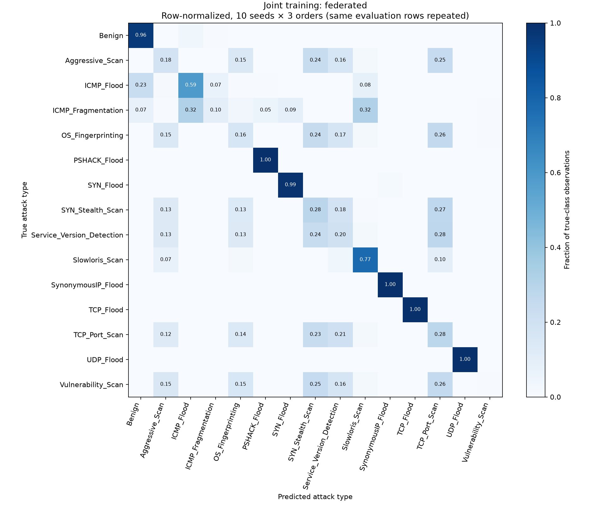
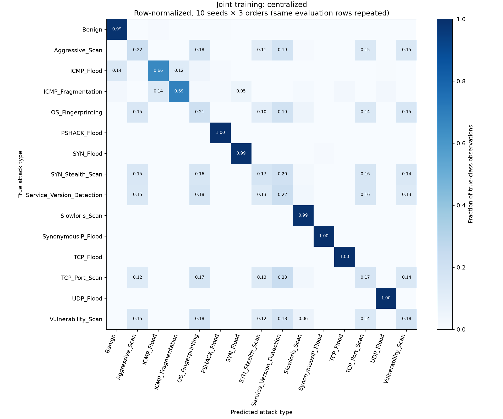

# Joint-training confusion diagnosis

The original ~55% figure is old-task type accuracy averaged over three tasks; it is not the same quantity as single-task pilot accuracy or all-class accuracy. Single-task near-99% values came from selected easier tasks, not all 15 types.

Matrices use final predictions from all 60 existing joint runs. Rows=true, columns=predicted. Counts repeat the fixed evaluation observations across 10 seeds and three orders; they are not independent traffic samples. Row-normalized matrices summarize training randomness. No training labels were merged and no settings were selected using these evaluation results.

## federated
All-type accuracy mean: 57.21%; all-attack type accuracy: 57.12%; old-task accuracy: 55.39%.

| True type | Predicted type | Mean confused | Runs with ≥10% confusion |
|---|---|---:|---:|
| ICMP_Fragmentation | ICMP_Flood | 32.0% | 29/30 |
| ICMP_Fragmentation | Slowloris_Scan | 32.0% | 30/30 |
| Service_Version_Detection | TCP_Port_Scan | 27.6% | 22/30 |
| SYN_Stealth_Scan | TCP_Port_Scan | 26.6% | 22/30 |
| OS_Fingerprinting | TCP_Port_Scan | 26.1% | 22/30 |
| Vulnerability_Scan | TCP_Port_Scan | 25.7% | 21/30 |
| Aggressive_Scan | TCP_Port_Scan | 24.8% | 21/30 |
| Vulnerability_Scan | SYN_Stealth_Scan | 24.8% | 26/30 |
| OS_Fingerprinting | SYN_Stealth_Scan | 24.4% | 26/30 |
| Service_Version_Detection | SYN_Stealth_Scan | 24.2% | 25/30 |
| Aggressive_Scan | SYN_Stealth_Scan | 24.1% | 26/30 |
| TCP_Port_Scan | SYN_Stealth_Scan | 23.5% | 25/30 |
| ICMP_Flood | Benign | 23.3% | 25/30 |
| TCP_Port_Scan | Service_Version_Detection | 20.6% | 19/30 |
| SYN_Stealth_Scan | Service_Version_Detection | 18.3% | 16/30 |
## centralized
All-type accuracy mean: 59.56%; all-attack type accuracy: 59.47%; old-task accuracy: 63.51%.

| True type | Predicted type | Mean confused | Runs with ≥10% confusion |
|---|---|---:|---:|
| TCP_Port_Scan | Service_Version_Detection | 23.2% | 19/30 |
| SYN_Stealth_Scan | Service_Version_Detection | 19.6% | 18/30 |
| OS_Fingerprinting | Service_Version_Detection | 19.3% | 18/30 |
| Aggressive_Scan | Service_Version_Detection | 18.7% | 18/30 |
| Vulnerability_Scan | Service_Version_Detection | 18.1% | 18/30 |
| Vulnerability_Scan | OS_Fingerprinting | 18.0% | 15/30 |
| Aggressive_Scan | OS_Fingerprinting | 17.9% | 16/30 |
| Service_Version_Detection | OS_Fingerprinting | 17.7% | 17/30 |
| TCP_Port_Scan | OS_Fingerprinting | 17.3% | 16/30 |
| Service_Version_Detection | TCP_Port_Scan | 16.3% | 10/30 |
| SYN_Stealth_Scan | OS_Fingerprinting | 16.1% | 14/30 |
| SYN_Stealth_Scan | TCP_Port_Scan | 15.7% | 10/30 |
| OS_Fingerprinting | Vulnerability_Scan | 15.3% | 19/30 |
| SYN_Stealth_Scan | Aggressive_Scan | 15.0% | 19/30 |
| OS_Fingerprinting | Aggressive_Scan | 15.0% | 23/30 |

## Interpretation
Consistent confusion is evidence of errors under this model/training protocol, not proof that types are intrinsically indistinguishable. The frozen Task-1 representation, model capacity, optimization budget, federated client heterogeneity and class support can also limit joint performance. Training-loss traces are supplied for inspection; no single cause is asserted. Family-level scoring uses the already-defined four task groups, without retraining or choosing merged groups from evaluation errors. Supervisor review of these matrices precedes any future merged-label experiment.
